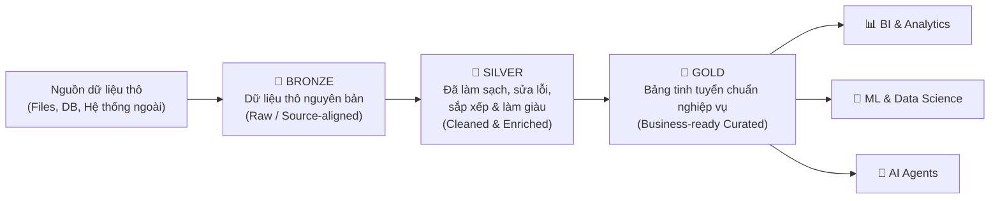
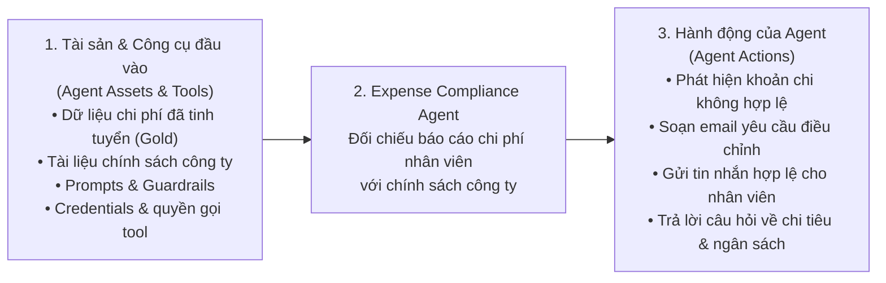

# Module 1: Oracle AI Data Platform Foundations

> **Nguồn:** Oracle MyLearn — *Oracle AI Data Platform: Data Foundations for Analytics and AI* (4 bài học, ~17 phút)  
> **Từ điển thuật ngữ chi tiết:** xem [glossary.md](./glossary.md)

---

## 1. Bức tranh toàn cảnh khóa học (Lesson 1: Course Overview)

- **Mục tiêu cốt lõi của AIDP:** Biến dữ liệu doanh nghiệp đang bị **phân mảnh** (*fragmented enterprise data*) ở nhiều nơi thành **tài sản dữ liệu đáng tin cậy, có ngữ cảnh nghiệp vụ** (*trusted, business-contextual assets*) để phục vụ:
  1. **Analytics** (Phân tích & báo cáo kinh doanh)
  2. **Machine Learning (ML) & Data Science** (Học máy & khoa học dữ liệu)
  3. **AI-driven applications & Agentic AI workflows** (Ứng dụng AI & quy trình AI Agent)
- **Lộ trình 7 module của khóa học:**
  1. **Module 1:** Khái niệm nền tảng AIDP, Lakehouse, Medallion & kịch bản xuyên suốt
  2. **Module 2:** Khởi tạo một instance AIDP (*Provisioning*)
  3. **Module 3:** Tổ chức dữ liệu với Catalog, Schema, Table, Volume & bảo mật phân quyền **RBAC** (*Role-Based Access Control*)
  4. **Module 4:** Tạo **Workspace** (không gian làm việc) và **Compute Cluster** (cụm máy tính xử lý)
  5. **Module 5:** Dùng **Notebooks** chạy code và biến đổi dữ liệu
  6. **Module 6:** Tự động hóa bằng **Workflows** (lập lịch, giám sát, xử lý lỗi)
  7. **Module 7:** Chia sẻ dữ liệu an toàn (**Delta Sharing**) và kết nối với **Oracle Analytics Cloud (OAC)** & công cụ phân tích bên ngoài

---

## 2. Oracle AI Data Platform (AIDP) là gì? (Lesson 2: Introduction to AIDP)

### Định nghĩa ngắn gọn
**AIDP** là một **Managed Oracle Cloud Service** (dịch vụ đám mây do Oracle tự quản lý hạ tầng) cung cấp **một không gian làm việc có quản trị thống nhất** (*governed workspace*), gom 5 nhóm năng lực vào cùng một chỗ:
1. **Cataloging & Governance** (Lập danh mục & Quản trị dữ liệu)
2. **Data Preparation** (Chuẩn bị, làm sạch dữ liệu)
3. **Compute & Workflows** (Tài nguyên tính toán & Tự động hóa quy trình)
4. **Analytics & ML/Data Science development** (Phân tích & phát triển mô hình học máy)
5. **Agent / Application integration** (Tích hợp AI Agent & ứng dụng)

### Tại sao doanh nghiệp cần AIDP?
Nếu thiếu một nền tảng thống nhất (dữ liệu, quản trị và công cụ AI phát triển rời rạc), doanh nghiệp gặp 4 "điểm nghẽn" (*friction points*):
- **Fragmented data:** Dữ liệu phân mảnh, nằm rải rác nhiều hệ thống.
- **Inconsistent controls:** Phân quyền/bảo mật mỗi nơi một kiểu, dễ rò rỉ hoặc sai lệch.
- **Disconnected processing tools:** Các công cụ xử lý không kết nối liền mạch với nhau.
- **Insufficient trusted context:** AI / Agent thiếu dữ liệu đáng tin và ngữ cảnh nghiệp vụ rõ ràng → dễ trả lời sai.

### Ai dùng AIDP? (4 vai trò chính)
| Vai trò | Họ làm gì trong AIDP? |
|---|---|
| **Data Engineer** *(Kỹ sư dữ liệu)* | Xây & quản lý **data pipelines** (đường ống dữ liệu), tự động hóa **workflows**, tối ưu tài nguyên tính toán. |
| **Data Analyst** *(Chuyên viên phân tích)* | Tìm kiếm (*discover*), truy vấn (*query*) và phân tích dữ liệu để tạo insight cho kinh doanh. |
| **Data Scientist** *(Nhà khoa học dữ liệu)* | Dùng tài nguyên tính toán mở rộng linh hoạt (*scalable compute*) để làm ML và phân tích nâng cao bằng công cụ/thư viện quen thuộc. |
| **Data Steward** *(Người giám hộ dữ liệu)* | Giám sát **data governance** (quản trị), **privacy** (quyền riêng tư) và **compliance** (tuân thủ quy định) toàn tổ chức. |

### Công nghệ chuẩn mở bên trong AIDP (Open Technologies & Standards)
Thay vì ép bạn học công nghệ độc quyền đóng kín, AIDP đóng gói các chuẩn mở quen thuộc vào một nền tảng được Oracle quản trị sẵn:
- **Apache Spark:** Công cụ xử lý dữ liệu phân tán (chạy song song nhiều máy) cho làm sạch, biến đổi, phân tích dữ liệu lớn.
- **Delta Lake:** Định dạng bảng Lakehouse đáng tin cậy (lưu trên kho lưu trữ giá rẻ nhưng vẫn đảm bảo toàn vẹn dữ liệu như database).
- **Delta Sharing:** Chia sẻ dữ liệu có quản trị ra bên ngoài **mà không cần sao chép nhân bản dữ liệu** (*without unnecessary duplication*).
- **Iceberg & Hudi interoperability:** Tương thích với các định dạng bảng mở phổ biến khác là **Apache Iceberg** và **Apache Hudi**.
- **JDBC Connectivity:** Kết nối chuẩn giúp công cụ BI và ứng dụng bên ngoài truy vấn dữ liệu đã được quản trị trong AIDP.

### Kiến trúc Huy chương — Medallion Architecture (Bronze → Silver → Gold)
Đây là mô hình phân chia dữ liệu theo **mức độ sẵn sàng (readiness)**, rất giống quy trình nấu ăn trong nhà hàng:

- **Bronze tier (Tầng Đồng):** Chứa dữ liệu thô nguyên trạng ngay khi mới nạp (*ingested*) từ hệ thống nguồn. (Ví dụ: thực phẩm tươi sống mới nhập kho, chưa rửa chưa cắt.)
- **Silver tier (Tầng Bạc):** Dữ liệu xử lý từ Bronze — đã được **làm sạch** (*cleaned*), **sắp xếp** (*organized*), **sửa lỗi** (*corrected*) và **làm giàu thêm thông tin** (*enriched*). (Ví dụ: nguyên liệu đã sơ chế sạch sẽ, phân loại sẵn.)
- **Gold tier (Tầng Vàng):** Dữ liệu xử lý từ Silver — trở thành **tài sản tinh tuyển sẵn sàng cho nghiệp vụ** (*business-ready curated tables*) để phục vụ trực tiếp báo cáo, phân tích, ML và AI Agents. (Ví dụ: món ăn đã nấu chín, bày đĩa sẵn sàng phục vụ khách.)
- **Giá trị của Medallion:** Nâng chất lượng dữ liệu từng bước một cách rõ ràng, đồng thời vẫn giữ nguyên dấu vết truy ngược từ dữ liệu cuối về dữ liệu gốc.

> **Lưu ý quan trọng từ giảng viên:** AIDP cung cấp môi trường có quản trị và tái sử dụng được, **nhưng AIDP không tự thiết kế quy trình thay cho bạn**. Đội ngũ vẫn phải tự quyết định cách nạp, làm sạch, kiểm tra tính hợp lệ (*validate*), tinh tuyển (*curate*) và quản trị dữ liệu; AIDP giúp biến các quyết định đó thành hệ thống vận hành trơn tru và lặp lại được.

---

## 3. Kiến trúc Data Lakehouse là gì? (Lesson 3: Understand Data Lakehouse Architecture)

### So sánh nhanh 3 khái niệm cho người mới
| Kiến trúc | Điểm mạnh nhất | Hạn chế nếu đứng một mình |
|---|---|---|
| **Data Warehouse** *(Kho dữ liệu)* | Rất mạnh cho dữ liệu có cấu trúc rõ ràng, quản trị chặt, truy vấn **SQL** nhanh cho báo cáo BI. | Khó và tốn kém khi lưu dữ liệu thô đa dạng (PDF, log, ảnh, JSON lớn...). |
| **Data Lake** *(Hồ dữ liệu)* | Lưu được lượng dữ liệu khổng lồ, đa dạng kiểu (thô, bán cấu trúc, phi cấu trúc), linh hoạt. | Thiếu quản trị bảng, bảo mật và tối ưu truy vấn mạnh như Warehouse. |
| **Data Lakehouse** *(Nhà-Hồ dữ liệu)* | **Kết hợp cả hai:** Sự linh hoạt & quy mô của Data Lake + Khả năng quản trị, bảo mật & truy vấn của Data Warehouse. | — |

### Những điểm cốt lõi cần nhớ về Data Lakehouse
1. **Không chỉ là nơi lưu trữ (*not just storage*):** Một Lakehouse thực thụ phải kết hợp đủ 6 thành phần: **Storage** (lưu trữ) + **Table Management** (quản lý bảng) + **Metadata** (siêu dữ liệu) + **Security** (bảo mật) + **Processing Engines** (động cơ xử lý như Spark) + **Governance Controls** (kiểm soát quản trị).
2. **Mục tiêu thực tế:** **Không phải** để xóa sổ mọi Warehouse hay mọi Lake hiện có, mà để **giảm các đường ống xử lý trùng lặp** (*reduce duplicate paths*) và tạo một nền tảng có quản trị chung cho cả Analytics, ML/DS và AI.
3. **4 lợi ích thiết thực:**
   - Ít đường ống dữ liệu trùng lặp hơn (*fewer duplicate pipelines*)
   - Phân quyền & quản trị nhất quán hơn (*more consistent access & governance*)
   - Ít di chuyển/copy dữ liệu qua lại hơn (*less data movement*)
   - Nền tảng tốt hơn cho cả Analytics lẫn AI
4. **Lakehouse vận hành trong AIDP như thế nào?**
   - **Catalogs & governed datasets** → Tổ chức tài sản dữ liệu.
   - **Notebooks, Spark compute & Workflows** → Biến đổi dữ liệu và tự động hóa.
   - **Giá trị cốt lõi của AIDP:** **Catalogs, Access Control (phân quyền), Audit (nhật ký kiểm toán), và Lineage (truy vết nguồn gốc dữ liệu)** được **dùng chung xuyên suốt toàn bộ nền tảng** — dữ liệu, luồng xử lý và quản trị luôn gắn liền với nhau.

---

## 4. Kịch bản xuyên suốt khóa học (Lesson 4: Explore the Learning Path Scenario)

Xuyên suốt cả 7 module (và cả lộ trình chứng chỉ), ví dụ thực tế được dùng là xây dựng một **Expense Compliance Agent** (*AI Agent kiểm tra tuân thủ chi phí nhân viên*).

- **Vai trò của khóa học này trong kịch bản:** Trước khi AI Agent có thể hoạt động chính xác, ta phải **chuẩn bị và quản trị dữ liệu chi phí** đi từ dạng thô (Bronze) → sạch (Silver) → tinh tuyển (Gold). Đó chính là lý do khóa học này có tên **Data Foundations for Analytics and AI**!

---

## 5. Câu hỏi tự kiểm tra nhanh (Module 1)

1. Nếu dữ liệu chi phí nhân viên vừa mới tải lên hệ thống từ file CSV gốc (còn dòng trùng lặp, sai định dạng ngày tháng), nó thuộc tầng nào trong **Medallion Architecture** (*Bronze, Silver hay Gold*)?
2. Công nghệ nào trong AIDP giúp chia sẻ dữ liệu có quản trị cho bên ngoài **mà không cần sao chép nhân bản dữ liệu**?
3. Trong AIDP, vai trò nào chịu trách nhiệm chính về **quản trị dữ liệu (governance), quyền riêng tư (privacy) và tuân thủ quy định (compliance)**?
4. Đúng hay Sai: *"Mục tiêu của kiến trúc Data Lakehouse là thay thế hoàn toàn mọi Data Warehouse và Data Lake hiện có."*
