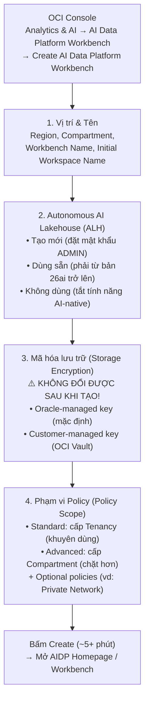

# Module 2: Provision an AIDP Instance

> **Nguồn:** Oracle MyLearn — *Oracle AI Data Platform: Data Foundations for Analytics and AI* (2 bài học: Lý thuyết 8p + Demo 3p)  
> **Từ điển thuật ngữ chi tiết:** xem [glossary.md](./glossary.md)

---

## 1. Provisioning tạo ra những gì?

**Provisioning** *(khởi tạo tài nguyên đám mây)* là bước "dựng nền móng" trước khi đội ngũ có thể nạp dữ liệu hay chạy AI. Khi khởi tạo AIDP, hệ thống tạo đồng thời **2 thành phần cốt lõi**:

1. **Workbench Instance** *(Thể hiện hệ thống AIDP)*: Môi trường bảo mật tổng thể cho mọi hoạt động dữ liệu, phân tích và AI (ví dụ: như "cả tòa nhà văn phòng").
2. **Initial Workspace** *(Không gian làm việc mặc định đầu tiên)*: Khu vực dự án để nhóm tổ chức **Workflows** *(luồng chạy tự động)*, **Notebooks** *(sổ tay viết code)*, **Libraries** *(thư viện phần mềm)* và các công việc liên quan (ví dụ: như "phòng dự án đầu tiên trong tòa nhà").

---

## 2. Điều kiện chuẩn bị trước khi tạo (OCI IAM & Tags)

AIDP chạy trên **OCI (Oracle Cloud Infrastructure)** — nền tảng điện toán đám mây của Oracle. Người tạo instance cần nắm 5 khái niệm cơ bản của **OCI IAM** (*Identity and Access Management — Quản lý danh tính & phân quyền*):
- **User** *(Người dùng)* và **Group** *(Nhóm người dùng)*
- **Policy** *(Chính sách cấp quyền — quy định nhóm nào được làm gì ở đâu)*
- **Region** *(Vùng địa lý đặt trung tâm dữ liệu đám mây)*
- **Compartment** *(Ngăn chứa logic dùng để gom nhóm và kiểm soát quyền truy cập tài nguyên trên OCI)*

**2 yêu cầu bắt buộc trước khi bấm tạo:**
1. **Quyền mức `manage` (Manage-level permissions):** Bạn cần quyền quản trị (`manage`) đối với tài nguyên AI Data Platform trong **Compartment** nơi muốn tạo instance. (Khi bấm tạo trên OCI Console, hệ thống sẽ kiểm tra IAM policy trước khi mở form.)
2. **Kiểm tra Required Tags *(Nhãn bắt buộc)*:** Một số compartment yêu cầu gắn **Tags** *(nhãn phân loại, ví dụ tên dự án/phòng ban để tính chi phí)* mỗi khi tạo tài nguyên. **Nếu thiếu required tags, quá trình tạo instance sẽ thất bại!**

---

## 3. 4 quyết định cấu hình quan trọng khi khởi tạo

### Quyết định 1: Autonomous AI Lakehouse (ALH) — Bật hay tắt tính năng AI-native?
**Autonomous AI Lakehouse (ALH)** là cơ sở dữ liệu Lakehouse tự quản trị của Oracle đi kèm AIDP. Khi tạo instance, bạn có 3 lựa chọn:
- **Create new:** Tạo mới luôn một ALH cùng lúc (cần đặt mật khẩu cho tài khoản quản trị `ADMIN`).
- **Use existing:** Nối vào một ALH đã có sẵn — **bắt buộc phải từ phiên bản `26ai` trở lên!**
- **None (Không dùng):** Không kết nối ALH.

| Trạng thái kết nối ALH | AIDP làm được gì? |
|---|---|
| **Có kết nối ALH** *(khuyên dùng)* | Đầy đủ tính năng dữ liệu **+ mở khóa AI-native capabilities**: **Knowledge Bases** *(cơ sở tri thức cho AI)*, **Agent Flows** *(luồng AI Agent)* và **AI Compute**. |
| **Không kết nối ALH** | Vẫn nạp (*ingest*) và biến đổi (*transform*) dữ liệu có cấu trúc bình thường, nhưng **mọi tính năng AI-native bị vô hiệu hóa (disabled)**. |

### Quyết định 2: Storage Encryption Keys *(Khóa mã hóa dữ liệu lưu trữ)*
AIDP **tự động mã hóa** dữ liệu lưu trữ. Bạn chọn ai giữ chìa khóa mã hóa:

| Tùy chọn | Cách hoạt động | Ưu / Nhược điểm |
|---|---|---|
| **Oracle-managed key** *(Mặc định)* | Oracle tự tạo và quản lý chìa khóa. | Đơn giản nhất, không phải tự vận hành hay lo mất khóa. |
| **Customer-managed key** *(qua **OCI Vault**)* | Công ty bạn tự tạo và giữ khóa trong kho khóa **OCI Vault**. | Kiểm soát trực tiếp việc xoay vòng khóa (*key rotation*), phạm vi truy cập và kiểm toán (*audit trail*). **Rủi ro:** Nếu Vault/Key gặp sự cố, bị tắt (*disabled*), bị xóa (*deleted*) hoặc lên lịch xóa → **lỗi hệ thống và mất quyền truy cập dữ liệu được bảo vệ!** |

> **Cực kỳ quan trọng (hay ra thi!):** **Không thể thay đổi tùy chọn khóa mã hóa sau khi instance đã được tạo.** Nếu sau này muốn đổi (ví dụ từ Oracle-managed sang Customer-managed), bắt buộc phải **tạo một AIDP instance mới hoàn toàn rồi di chuyển (*migrate*) code và tài sản sang**.

### Quyết định 3: Policy Scope *(Phạm vi áp dụng chính sách quyền)*
Trong mục **Add policies → Choose access level**, bạn xác định nơi AIDP tạo/áp dụng các OCI IAM policy để tương tác với dịch vụ OCI khác:

| Tùy chọn | Phạm vi áp dụng | Đánh đổi *(Trade-off)* |
|---|---|---|
| **Standard** *(Khuyên dùng)* | **Tenancy level** *(Toàn bộ tài khoản thuê bao OCI của tổ chức)* | **Đơn giản (Simplicity):** Dễ khởi động (*onboarding*), ít phải chỉnh sửa IAM policy thủ công về sau. |
| **Advanced** | **Compartment level** *(Chỉ trong ngăn chứa chỉ định)* | **Kiểm soát chặt (Control):** Ranh giới bảo mật hẹp hơn, nhưng mỗi khi instance cần truy cập thêm compartment khác thì phải tự cập nhật IAM policy thủ công. |

- **Optional policies:** Có thể bật thêm để phân quyền chi tiết hơn (*fine-grained access control*), ví dụ khi cần kết nối với nguồn dữ liệu nằm trong **Private Networks** *(mạng riêng nội bộ không mở ra Internet)*.
- **Lưu ý:** Có thể tinh chỉnh quyền về sau bằng OCI IAM policies, nhưng tài liệu không xác nhận có thể đổi trực tiếp lựa chọn *Policy Scope* ban đầu ngay trên giao diện sau khi đã tạo.

---

## 4. Quy trình thao tác trên OCI Console & Giao diện AIDP (Lesson 2: Demo)

### Các bước bấm trên OCI Console
1. Mở menu điều hướng OCI Console → **Analytics & AI** → **AI Data Platform** → **AI Data Platform Workbench**.
2. Bấm **Create AI Data Platform Workbench** (OCI tự kiểm tra IAM policy trước khi mở hộp thoại).
3. Đặt tên instance (trong Demo: `expense AIDP`) và tên **Default/Initial Workspace**.
4. Chọn cấu hình **Autonomous AI Lakehouse** (Demo chọn `Create new`, giữ username `ADMIN` và nhập mật khẩu).
5. Chọn **Storage encryption** (`Oracle-managed key` hoặc `Customer-managed key`).
6. Mở **Show advanced options** nếu cần gắn **Tags** bắt buộc.
7. Chọn **Policy scope** (`Standard` hoặc `Advanced`) và **Optional policies** nếu cần nối mạng riêng.
8. Bấm **Create** và chờ **ít nhất khoảng 5 phút** để khởi tạo xong → bấm vào tên instance (đăng nhập nếu được hỏi) để vào **AIDP Homepage**.

### Khám phá giao diện AIDP Workbench
- **Master Catalog:** Nơi tập trung tổ chức mọi tài sản dữ liệu (sẽ học kỹ ở Module 3).
- **Workspaces:** Không gian dự án chứa notebooks, workflows, libraries.
- **Thanh điều hướng bên trái (Left Navigation):**
  - **Workflow & Compute:** Xử lý dữ liệu và tự động hóa.
  - **Data Sharing & Auto-Populate Catalog:** Chia sẻ dữ liệu và tự động khám phá/đăng ký danh mục.
  - **Notifications, Roles, Audit Logs:** Cảnh báo vận hành, phân quyền vai trò và nhật ký kiểm toán.
- **Mục Sample Code (ngay trên Homepage):** Bấm **Browse** sẽ mở kho GitHub công khai `oracle-samples/oracle-aidp-samples` (gồm các thư mục mẫu như `ai`, `data-engineering`, `getting-started`, `observabilityDashboards`, `shared-utils`...) để bạn học và dùng thử code mẫu nhanh.

---

## 5. Câu hỏi tự kiểm tra nhanh (Module 2)

1. Nếu bạn muốn kết nối AIDP với một **Autonomous AI Lakehouse (ALH) có sẵn**, phiên bản tối thiểu của ALH đó phải là gì? Nếu bạn chọn **không** kết nối ALH thì điều gì xảy ra?
2. Sau khi đã tạo AIDP instance bằng **Oracle-managed key**, công ty yêu cầu đổi sang **Customer-managed key** trên OCI Vault. Bạn có thể vào Settings bấm đổi trực tiếp được không?
3. Khác biệt chính giữa **Standard** và **Advanced** trong mục **Policy Scope** là gì?
4. Tại sao việc tạo AIDP instance có thể thất bại dù bạn đã có đủ quyền `manage` trên compartment?
