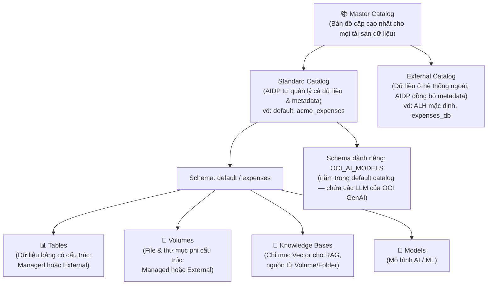

# Module 3: Data Foundation, Catalogs, and Governance

> **Nguồn:** Oracle MyLearn — *Oracle AI Data Platform: Data Foundations for Analytics and AI* (7 bài học: 3 bài lý thuyết + 4 bài Demo, ~47 phút)  
> **Từ điển thuật ngữ chi tiết:** xem [glossary.md](./glossary.md)

---

## Phần A — Tổ chức tài sản dữ liệu (Catalogs, Schemas, Tables, Volumes, Knowledge Bases)

### 1. Bản đồ phân cấp tài sản trong AIDP

- Khi mới tạo một AIDP instance, **Master Catalog** đã có sẵn **2 catalog**:
  1. **`default`** *(Standard Catalog)* — có sẵn 2 schema: `default` (dùng như schema chuẩn) và **`OCI_AI_MODELS`** (schema dành riêng liệt kê các mô hình ngôn ngữ lớn **Foundation LLMs** khả dụng từ dịch vụ **OCI Generative AI**, kèm code mẫu sử dụng).
  2. **External Catalog** kết nối sẵn với **Autonomous AI Lakehouse (ALH)** mà bạn chọn ở bước Provisioning.

### 2. So sánh nhanh các cặp khái niệm cốt lõi

#### A. Standard Catalog vs. External Catalog
| Tiêu chí | Standard Catalog | External Catalog |
|---|---|---|
| **Ai quản lý dữ liệu?** | **AIDP** lưu trữ và quản lý trực tiếp cấu trúc, tài sản và metadata. | Dữ liệu vẫn nằm nguyên ở **hệ thống được quản trị bên ngoài** (vd: database/ALH khác kết nối qua Wallet). |
| **Cách hoạt động** | Chứa đầy đủ **Tables, Volumes, Knowledge Bases, Models**. | AIDP **đồng bộ (synchronize) metadata** để khám phá và truy vấn **mà không cần copy dữ liệu** vào AIDP (chủ yếu External Tables & Volumes). |
| **Tạo object mới** | Tạo trực tiếp trên giao diện UI hoặc bằng code. | Không tạo thêm object qua UI được — **chỉ tạo qua code** *(theo Demo)*. |

#### B. Managed vs. External (áp dụng cho cả Table & Volume)
| Loại tài sản | Managed *(AIDP tự quản lý)* | External *(Trỏ ra OCI Object Storage)* |
|---|---|---|
| **Table** *(Dữ liệu bảng có cấu trúc)* | Upload file từ máy tính lên → AIDP quản lý **cả dữ liệu lẫn metadata**. | Trỏ tới file sẵn có trong **OCI Object Storage** (Compartment + Bucket + Folder) → AIDP **chỉ quản lý metadata**; hỗ trợ thêm **Partition keys** *(khóa phân vùng)*. |
| **Volume** *(File & thư mục phi cấu trúc)* | AIDP tự tạo vùng lưu trong OCI Object Storage và quản lý **cả dữ liệu lẫn metadata** (vd: `expense_policies`). | Trỏ tới vị trí OCI Object Storage sẵn có → AIDP **chỉ quản lý metadata** (nhưng vẫn tự hiển thị các file sẵn có và cho upload/tạo subfolder). |

### 3. Knowledge Bases *(Cơ sở tri thức cho RAG)*
**Knowledge Base** lập chỉ mục tài liệu phi cấu trúc thành **Vector Embeddings** *(biểu diễn bằng dãy số mang ý nghĩa ngữ nghĩa)* để AI Agent tìm kiếm theo ý nghĩa (**Semantic Search**) thông qua **RAG (Retrieval-Augmented Generation)**.

- **Động cơ phía sau:** Sử dụng **Oracle Database 26ai Vector Search** của Autonomous AI Lakehouse.
- **Định dạng tài liệu hỗ trợ:** **PDF, DOCX, TXT**.
- **Lưu ý cực quan trọng:** Knowledge Base chỉ nạp (**ingest**) **một Volume hoặc một Folder bên trong Volume**, **KHÔNG nạp từng file lẻ trực tiếp**! Vì vậy cần tổ chức thư mục trong Volume gọn gàng.
- **Cấu hình khi tạo (từ Demo `expense_policies_kb`):**
  - **Compute Cluster:** Có thể chọn **All-purpose compute cluster** trong workspace; nếu **để trống**, hệ thống dùng **default master catalog compute**.
  - **Embedding Model *(Mô hình chuyển văn bản thành vector)*:**
    - `ALL_MINILM_L12_V2`: **Chỉ hỗ trợ tiếng Anh (English only)**.
    - `MULTILINGUAL_E5_SMALL`: **Hỗ trợ 100 ngôn ngữ** (dùng cho tiếng Việt hoặc dữ liệu đa ngôn ngữ).
  - **Chunk size** *(Kích thước mỗi đoạn cắt theo số ký tự, demo: `100`)* và **Chunk overlap** *(Số ký tự gối lên nhau giữa 2 đoạn liên tiếp để giữ mạch ngữ cảnh, demo: `25`)*.
  - Sau khi tạo → vào tab **Data Sources** thêm Volume/Folder → có thể bấm **Ingest Now** chạy ngay hoặc đặt lịch (*schedule*).

### 4. Auto Populate Catalog *(Tự động quét & tạo danh mục)*
Giúp tiết kiệm công sức khi có rất nhiều file dữ liệu trong **OCI Object Storage** mà không muốn khai báo tay từng bảng:
- **Cách chạy:** Menu trái → **Auto-populate catalog** → `+` tạo **Metadata Extractor**.
- **Yêu cầu cấu hình:** Chọn **Standard Catalog** đích, chọn **Compute Cluster** để chạy, chỉ định vị trí **OCI Object Storage** (chọn Compartment/Bucket/Folder hoặc nhập **Object URI** thủ công).
- **Định dạng hỗ trợ:** **CSV, JSON, Avro, ORC, Parquet, Delta Lake**.
- **2 chế độ tạo thực thể (`Create entities`):**
  - **Automatically:** Tự động tạo luôn schemas, tables, partitions.
  - **Manually:** Chạy xong chuyển trạng thái từ `In-progress` → `In review`. Bạn vào tab **Entities awaiting review** kiểm tra từng bảng/cột, có thể đổi tên bảng, rồi bấm **Accept all → Submit**.

---

## Phần B — Bảo mật, Quản trị & Giám sát (Credential Store, RBAC, Audit Logs)

### 5. Credential Store *(Kho lưu thông tin bí mật tập trung)*
Thay vì dán cứng (*hardcode*) mật khẩu hay API token vào trong code (cực kỳ mất an toàn!), **Credential Store** lưu tập trung mọi thông tin xác thực để Notebooks, Workflows và AI Agents (vd: gọi **MCP Server** của Oracle Analytics Cloud) gọi ra an toàn bằng thư viện **AIDP utils (`secrets` syntax)**.

| Loại Credential | Dùng khi nào? |
|---|---|
| **Secret token** | Tự định nghĩa 1 hoặc nhiều cặp `key–value` (vd: key `access token` + giá trị token). Khi token hết hạn, bấm **Edit** để cập nhật giá trị mới. |
| **Service account** | Lưu thông tin của một tài khoản người dùng OCI (*OCI user account*). |
| **Vault reference** | Tham chiếu tới secret đã tạo sẵn trong **OCI Vault** chỉ bằng cách nhập **OCID** *(mã định danh duy nhất trên OCI)*. |

- **Best practices:** Đặt tên và mô tả rõ ràng, chỉ chia sẻ quyền dùng cho đúng người/role cần thiết, kiểm tra lịch sử sử dụng/thay đổi qua details & history.

### 6. RBAC (Role-Based Access Control) & Least-Privilege Access

**RBAC** *(Phân quyền theo vai trò)*: Gom quyền vào một **Role** *(vai trò)* rồi gán người dùng vào Role đó thay vì cấp quyền thủ công cho từng người trên từng bảng.

#### 2 System Roles mặc định trong AIDP
1. **`AI_DATA_PLATFORM_ADMIN`:**
   - Gán cho người đã khởi tạo AIDP instance; có toàn quyền Admin trên mọi đối tượng, cấp/thu hồi quyền.
   - **Quy tắc quan trọng:** **Chỉ có MỘT người dùng duy nhất (only one user at a time)** được giữ system role này trên một instance! Thành viên role này tự động có trong `AUDITOR`.
2. **`AUDITOR`:**
   - Chỉ được xem **Audit Logs** mà không có toàn quyền quản trị hệ thống (mặc định không có thành viên ngoài admin).

#### Quy trình thiết lập Custom Role & Cấp quyền chuẩn (từ Demo `AI_Agent_Developers`)
1. **Tạo Role:** Menu trái → **Roles** → `+` → đặt tên (vd: `AI_Agent_Developers`, `Data_Engineer`).
2. **Thêm thành viên (`Members` tab):** Hỗ trợ 3 loại **Principal Type**:
   - **User:** Nhập OCID hoặc chọn từ Compartment + Domain.
   - **Group:** Thêm cả một **OCI IAM Group** (vd: `BI Data Model Author`).
   - **Role:** Lồng một Role AIDP khác vào (mọi thành viên của role con tự động trở thành thành viên role cha!).
3. **Cấp quyền trên ĐỐI TƯỢNG ĐÍCH (Target Object):**
   - ⚠️ **Nguyên tắc cốt lõi:** Quyền **KHÔNG cấp từ trang Roles** — phải mở **tab `Permissions` của chính đối tượng đích** (Master Catalog, Catalog, Workspace, Folder, Compute...) rồi gán Role vào đó!
   - **Master Catalog permissions** rất mạnh, cần thận trọng: `CREATE_CATALOG`, `CREATE_CREDENTIAL`, `ADMIN` (toàn quyền trên catalog, credential, share, recipient và toàn bộ đối tượng con).
   - **Kế thừa phân cấp (*Hierarchical Inheritance*):** Cấp quyền trên đối tượng cha (vd: `MANAGE` trên Catalog `acme_expenses`) tự động kế thừa xuống các Table bên trong.
   - ⚠️ **Các cây phân quyền RIÊNG BIỆT (rất dễ quên!):**
     - **Workspace** (vd: quyền `Privileged User` → cho vào workspace, tạo file/folder, quản lý shared folder, tạo compute) **KHÔNG tự động** bao gồm quyền trên Folder hay Compute!
     - **Folder:** Phải vào Folder → `Permissions` → cấp `Manage` và tick chọn **Inherit to all subfolders and items**.
     - **Compute & AI Compute:** Phải vào từng Compute cluster và AI Compute → `Permissions` → cấp quyền **`USE`**.

#### Nguyên tắc đặc quyền tối thiểu (*Least-Privilege Access*)
- **Data Engineers:** Tạo/quản lý catalogs, schemas, tables, volumes.
- **Analysts:** Chỉ truy vấn (*query*) các bộ dữ liệu được phê duyệt.
- **Reviewers:** Chỉ đọc (*read-only*) kết quả tinh tuyển và tài liệu chính sách hỗ trợ.
- **Agent Runtime Access *(cần kiểm soát đặc biệt chặt)*:** Vì AI Agent có thể gọi tools, dùng credentials và gọi dịch vụ ngoài → chỉ cấp quyền đúng các **Knowledge Bases, SQL queries, Credentials và Tools** được phê duyệt!

### 7. Phân biệt Notifications vs. Audit Logs
| | **Notifications** *(Thông báo vận hành)* | **Audit Logs** *(Nhật ký kiểm toán)* |
|---|---|---|
| **Mục đích** | Theo dõi **trạng thái & kết quả tức thời** của các tác vụ đang chạy. | Bản ghi **lâu dài (persistent)** để kiểm tra, đối chiếu bảo mật và điều tra sự cố. |
| **Ghi lại gì?** | Tạo tài nguyên, upload file, metadata extraction, nạp Knowledge Base, chạy job (thành công/lỗi). | Cập nhật catalog, thay đổi quyền, chạy extraction, thao tác credential (**cái gì đổi, ai làm, thành công hay không**). |

---

## Câu hỏi tự kiểm tra nhanh (Module 3)

1. Bạn muốn tạo một **Knowledge Base** từ 1 file PDF duy nhất `policy_2026.pdf` bằng tiếng Việt. Bạn cần chú ý **2 điều gì** (về nguồn dữ liệu nạp vào và lựa chọn Embedding Model)?
2. Khi mới tạo AIDP instance, danh sách các mô hình LLM của OCI Generative AI nằm sẵn ở đâu trong **Master Catalog**?
3. Có thể cấp quyền cho 2 người cùng lúc giữ system role **`AI_DATA_PLATFORM_ADMIN`** trên cùng một AIDP instance không?
4. Sau khi bạn đã cấp quyền `Privileged User` cho role `AI_Agent_Developers` trên Workspace, các thành viên đó đã tự động dùng được **Compute Cluster** và **Folder** bên trong chưa? Tại sao?
