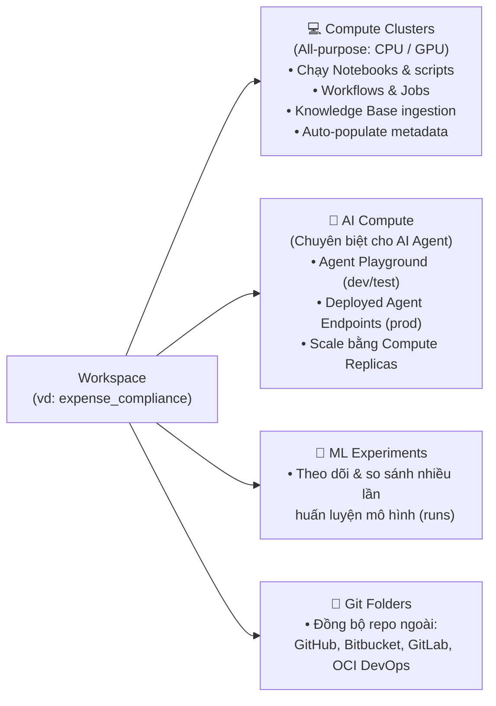

# Module 4: Create and Organize Workspaces and Compute Resources

> **Nguồn:** Oracle MyLearn — *Oracle AI Data Platform: Data Foundations for Analytics and AI* (4 bài học: 2 bài lý thuyết + 2 bài Demo, ~21 phút)  
> **Từ điển thuật ngữ chi tiết:** xem [glossary.md](./glossary.md)

---

## 1. Workspaces & Workspace Isolation *(Không gian làm việc & Cô lập dự án)*

### Workspace là gì?
**Workspace** là một **logical container** *(vùng chứa logic)* dùng để gom toàn bộ tài sản làm việc của một dự án vào một chỗ: **Files, Folders, Notebooks, Workflows, Jobs, Compute Clusters và Experiments**.
- Khi tạo AIDP instance, hệ thống tạo sẵn **`default_workspace`** để thử nghiệm nhanh (*early prototyping*).
- Nên tạo **Workspace riêng** khi cần ranh giới rõ ràng theo **nhóm sở hữu** (*team ownership*), **phạm vi dự án** (*project scope*), hoặc **môi trường vòng đời** (*lifecycle stages*: `dev`, `test`, `prod`).

### 2 lớp cô lập (*Workspace Isolation*)
| Lớp cô lập | Nó tách riêng những gì? | Tác dụng thực tế |
|---|---|---|
| **Operational Boundaries** *(Ranh giới vận hành)* | **Compute clusters, Workflows, Jobs, Logs, Quotas** *(hạn mức tài nguyên)* | Ngăn tác vụ nặng ở dự án này tranh chấp tài nguyên hoặc làm ảnh hưởng dự án khác. |
| **Organizational Boundaries** *(Ranh giới tổ chức)* | **Files, Notebooks, Workflows, Permissions** | Tách rõ trách nhiệm từng nhóm/môi trường (`dev`/`test`/`prod`) mà vẫn giữ quản trị tập trung. |

### Tùy chọn cấu hình & Thư mục bên trong Workspace (Demo)
- **Default Catalog *(tùy chọn)*:** Giúp gõ tên bảng thuộc catalog đó mà không cần ghi kèm tên catalog phía trước — *vẫn truy cập được các catalog khác bình thường*.
- **Enable Private Network *(tùy chọn)*:** Bật nếu cần nối tới nguồn dữ liệu trong mạng riêng → chọn **VCN** *(Virtual Cloud Network)* và **Subnet**.
- **Thư mục `Shared` có sẵn:** Bất kỳ ai có quyền **`user`** trên Workspace đều **tự động có quyền `manage`** đối với mọi đối tượng nằm trong thư mục `Shared` — cực tiện để làm việc nhóm.
- **Tổ chức theo Medallion Architecture:** Trong kịch bản, tạo thư mục `expense_medallion` và 3 thư mục con `bronze`, `silver`, `gold` để đặt notebook tương ứng từng tầng.
- **Phân quyền Workspace:** Mở Workspace → **Permissions** → cấp cho User / Group / Role (tạo file/folder, tạo compute, quản lý object hoặc quản trị workspace).

---

## 2. Compute Clusters vs. AI Compute *(2 loại tài nguyên tính toán)*

### So sánh trực diện Compute Clusters vs. AI Compute
| Tiêu chí | Compute Clusters *(Đa năng — All-purpose)* | AI Compute *(Chuyên biệt cho AI Agent)* |
|---|---|---|
| **Dùng cho việc gì?** | Hầu hết các tác vụ AIDP: chạy code trong **Notebooks** / file Python & SQL, **Workflows & Jobs**, **Knowledge Base ingestion**, **Metadata extraction**. | **CHỈ dùng cho AI Agents:** chạy **Agent Playground** *(môi trường thử nghiệm)* khi phát triển và vận hành **Deployed Agent Endpoints** *(điểm cuối phục vụ)* ở production. |
| **Cách cấu hình** | **Quickstart** *(nhanh, việc nhẹ — AMD Driver + Worker, autoscale sẵn)* hoặc **Custom** *(chọn CPU/GPU shape cho **Driver** & **Worker** nodes, với **NVIDIA GPU** chọn số GPU; tùy chỉnh **Spark configs** & **init scripts** trong Advanced options)*. | Cấu hình tối giản: chỉ chọn số **Compute Replicas** *(bản sao)*, **OCPUs** và **Memory (GB)**. |
| **Mở rộng quy mô (Scaling)** | Bật **Autoscale** *(tự tăng/giảm số lượng worker nodes theo min–max)*. | Tăng sức chịu tải bằng cách **thêm Compute Replicas**. |
| **Tiết kiệm chi phí** | Đặt **`Idle timeout`** *(tự tắt sau X phút không dùng, mặc định 120p, demo để 180p)* hoặc chạy `Forever`. | Tính theo **AIDP units/hour** dựa trên số replica, OCPU và RAM. |
| **Các tab quản lý chính** | `Event logs`, `Spark UI`, `Logs`, `Metrics`, **`Connection Details`** *(BI tools, JDBC/ODBC)*, `Notebooks`, **`Library`** *(cài thư viện từ file danh sách)*. | **`Agents`** *(các agent đang dùng)*, **`Compute Utilization`** *(mức sử dụng)*, `Details`. |

---

## 3. ML Experiments & Git Folders

### A. ML Experiments *(Thí nghiệm Học máy)*
- Ghi lại và so sánh kết quả của nhiều **training runs** *(lần chạy huấn luyện)* khác nhau (khác thuật toán, dữ liệu đầu vào, tham số thiết kế) ngay trong cùng nền tảng để chọn ra mô hình tốt nhất.
- Trong kịch bản: tạo experiment `expense_review_classifier` để huấn luyện mô hình phân loại giao dịch chi phí.

### B. Git Folders *(Thư mục tích hợp Git — Demo 4)*
Kết nối trực tiếp một thư mục trong Workspace tới một **Git repository & branch** bên ngoài để quản lý phiên bản code (**commit, push, pull, merge, branch management**) ngay trong AIDP.

**Quy trình 2 bước để tạo Git Folder:**
1. **Liên kết tài khoản Git (`Settings` → `User` → `Git linked accounts` → `+ Add credential`):**
   - Chọn **Git provider** (4 nhà cung cấp hỗ trợ: **`GitHub`**, **`Bitbucket`**, **`GitLab`**, **`OCI DevOps`**).
   - Nhập tên credential, email và **Personal Access Token (PAT)** *(trên GitHub tạo ở `Settings → Developer Settings → Personal Access Tokens` — Classic hoặc Fine-grained)*.
2. **Tạo Git Folder trong Workspace (`Content` → `+` → `Git folder`):**
   - Chọn Git credential vừa tạo, nhập **Git Repository URL**, đặt **Git folder name** và **Branch name** (vd: `main`) → **Create**.
   - Dùng tab **`Content`** để xem/upload/chỉnh sửa file và tab **`Git`** để xem danh sách thay đổi, nhập commit message rồi bấm **Commit & Push** (hoặc pull/merge).

---

## Câu hỏi tự kiểm tra nhanh (Module 4)

1. Trong AIDP, loại Compute nào được dùng để chạy **Notebooks, Workflows và nạp Knowledge Base**, còn loại nào chỉ dành riêng cho **Agent Playground và Deployed Agent Endpoints**?
2. Bạn muốn tăng sức chịu tải cho một **AI Agent** đang chạy ở production — bạn mở rộng tài nguyên **AI Compute** bằng cách nào?
3. Khi bạn cấp quyền `user` trên một Workspace cho đồng nghiệp, họ sẽ tự động có quyền gì bên trong thư mục **`Shared`** có sẵn của Workspace đó?
4. Để tạo **Git Folder** kết nối tới GitHub trong AIDP, bạn cần chuẩn bị loại thông tin xác thực gì từ GitHub và khai báo ở đâu trong AIDP?
