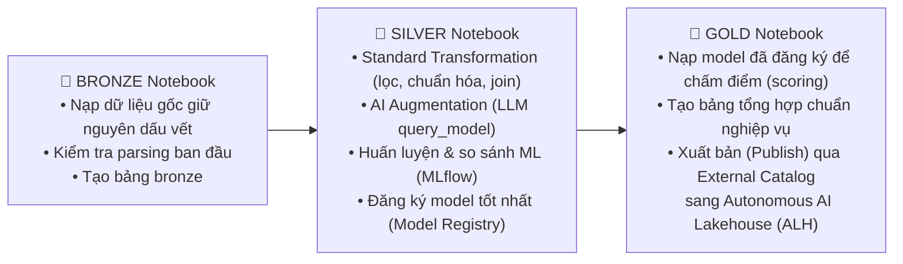

# Module 5: Running Code in AIDP Notebooks

> **Nguồn:** Oracle MyLearn — *Oracle AI Data Platform: Data Foundations for Analytics and AI* (3 bài học: 2 bài lý thuyết + 1 bài Demo, ~31 phút)  
> **Từ điển thuật ngữ chi tiết:** xem [glossary.md](./glossary.md)

---

## 1. Cấu trúc & Tính năng của AIDP Notebook (Lesson 1)

**AIDP Notebook** là môi trường phát triển tương tác (*interactive development environment*) gom code, khám phá dữ liệu, ghi chú và kết quả vào cùng một tài liệu.

### A. 3 loại ô (Cells) trong Notebook
| Loại Cell | Vai trò & Tính năng |
|---|---|
| **Code Cells** | Viết và chạy code bằng **Python** *(chuẩn bị dữ liệu, phân tích, ML)*, **SQL** *(truy vấn & biến đổi dữ liệu)*, **Scala** *(xử lý Spark gốc)*, cộng thêm lệnh shell/terminal cơ bản. Có thể chọn **Default language** cho cả notebook (`Actions` menu) và ghi đè từng ô (vd dùng `%%sql` trong notebook Python). |
| **Markdown Cells** | Viết tiêu đề, danh sách, giải thích ý định code → tự động tạo mục lục bên sidebar. |
| **Result Cells** | Hiển thị bảng/kết quả ngay dưới ô code; cho phép **copy** hoặc **tải về dưới dạng file CSV hoặc Excel**. |

### B. 4 Thanh bên tích hợp *(Integrated Sidebars)*
Giúp lập trình viên ít phải chuyển qua lại giữa nhiều màn hình (*reduce context switching*):
1. **Catalog Sidebar:** Duyệt Master Catalog; **kéo-thả** hoặc chuột phải chọn **Copy sample code / name / path** dán thẳng vào cell (áp dụng cho Tables, Volumes và cả các mô hình LLM trong `default.oci_ai_models`).
2. **Workspace Sidebar:** Di chuyển nhanh giữa các thư mục dự án (`bronze`, `silver`, `gold`, `shared`).
3. **Table of Contents Sidebar:** Mục lục tự sinh từ các tiêu đề Markdown trong notebook.
4. **Experiments Sidebar:** Xem trực tiếp các lần chạy huấn luyện (**runs**), chỉ số đo (**metrics**), tham số (**parameters**), file đầu ra (**artifacts**) và mô hình đã đăng ký (**registered models**).

### C. Quy ước đặt tên 3 phần *(Three-part Naming / Fully Qualified Name)*
Mọi bảng trong Master Catalog (dù thuộc **Standard Catalog** hay **External Catalog**) đều gọi chính xác bằng cú pháp:

```text
catalog.schema.table
```
Ví dụ: `df = spark.read.table("acme_expenses.expenses.acme_expenses")`
- **Tác dụng:** Giúp AIDP biết chính xác bảng nào cần đọc/ghi, tránh lỗi nhập nhằng (*ambiguous reference*) khi nhiều catalog hoặc schema có bảng trùng tên.

### D. Kiểm tra trước khi chạy & Phân loại 2 nhóm lỗi *(Troubleshooting)*
- **Trước khi bấm `Run all` hay đưa vào Workflow:**
  1. Đảm bảo đã gắn **Active Compute Cluster** (`Cluster → Attach existing cluster`).
  2. Kiểm tra kích cỡ cluster, runtime và **Cluster-level libraries** *(thư viện cài ở cấp cluster giúp notebook chạy tay và job tự động có môi trường đồng nhất)*.
  3. Chạy thử từng ô lẻ để kiểm tra kết quả trung gian trước khi chạy toàn bộ.
- **2 nhóm nguyên nhân lỗi thường gặp:**
  | Nhóm lỗi | Nguyên nhân điển hình |
  |---|---|
  | **Code Context Failures** *(Lỗi do code)* | Sai đường dẫn file, thiếu file CSV, sai tên catalog/cột, giả định trong code không khớp dữ liệu thực tế. |
  | **Compute Context Failures** *(Lỗi do hạ tầng tính toán)* | Cluster chưa chạy/lỗi trạng thái, thiếu RAM/CPU, sai phiên bản runtime, thiếu thư viện phụ thuộc (*missing library dependencies*). *(Xem Logs & Metrics để chẩn đoán.)* |

---

## 2. Biến đổi dữ liệu chuẩn vs. Làm giàu bằng AI (Lesson 2)



### So sánh 2 kiểu biến đổi dữ liệu trong Notebook
1. **Standard Transformation *(Biến đổi tất định — Deterministic)*:** Làm theo luật cố định như lọc dòng (*filtering*), nối bảng (*joining*), chuẩn hóa định dạng, ép kiểu dữ liệu (*type conversion*), tính cột mới, tổng hợp (*aggregating*).
2. **AI Augmentation *(Làm giàu bằng suy luận — Inference-based)*:**
   - **Generative AI (LLMs qua `default.oci_ai_models`):** Dùng cho văn bản tự do — trích xuất thông tin, phân loại, tóm tắt, phân tích cảm xúc (*sentiment*), tạo lý do giải thích.
   - **Machine Learning (MLflow):** Chuẩn bị đặc trưng (*features*), huấn luyện nhiều thuật toán ứng viên, chấm điểm (*scoring*) và phân loại tự động.

### Quy trình 4 bước kiểm định đầu ra LLM *(LLM Output Validation Sequence)*
Không bao giờ đổ thẳng kết quả AI sinh ra vào bảng chính thức mà chưa kiểm tra! Luôn làm đúng 4 bước:
1. **Định nghĩa yêu cầu:** Chốt rõ tên cột đích, định dạng mong đợi và các ràng buộc (*constraints*).
2. **Chạy thử mẫu nhỏ:** Test prompt trên tập bản ghi đại diện nhỏ (có chứa các trường hợp ngoại lệ / *edge cases*).
3. **Đánh giá chất lượng:** So sánh giá trị LLM sinh ra với bằng chứng ở dữ liệu gốc và tiêu chí chấp nhận (*acceptance criteria*).
4. **Xuất bản chọn lọc:** Chỉ ghi (*publish*) những đầu ra đã được kiểm định vào bảng **Silver** tinh tuyển.

---

## 3. Thực tế qua 3 Notebook Medallion trong Demo (Lesson 3)

### Cách gọi LLM trực tiếp từ SQL & PySpark bằng `query_model`
Chỉ cần vào sidebar **`default` → `oci_ai_models`** (có sẵn các họ model như Gemini, Cohere Command, Meta Llama, xAI Grok...), chuột phải chọn **Copy sample code**:
- **Trong SQL (`%%sql`):**
  ```sql
  query_model(
    'default.oci_ai_models.google.gemini-2.5-pro',
    CONCAT('Return one concise expense compliance review reason...', ...)
  ) AS llm_policy_review_reason
  ```
- **Trong PySpark:**
  ```python
  df.withColumn(
    '<output_col>',
    expr("query_model('default.oci_ai_models.google.gemini-2.5-pro', concat('<prompt>', <input_col>))")
  )
  ```

### Đường đi của dữ liệu & Mô hình qua 3 Notebook
1. **Bronze (`01_acme_expense_bronze_tier.ipynb`):**
   - Tạo schema `acme_expenses.bronze` bằng code (*programmatic asset creation*), nạp dữ liệu từ bảng nguồn, làm sạch bước đầu và gọi LLM sinh cột lý do xem xét (`llm_policy_review_reason`).
2. **Silver (Notebook Silver + MLflow):**
   - Tinh chế các bảng Silver (`expenses_silver`, `expenses_training_model_input_silver`...).
   - Dùng **MLflow** chạy huấn luyện nhiều mô hình ứng viên và ghi log vào experiment `expense_review_classifier` (xem tại sidebar **Experiments**: `Overview`, `Metrics`, `Parameters`, `Artifacts`).
   - So sánh và chọn mô hình có chỉ số **AUC** cao nhất → đăng ký vào **Model Registry** (`acme_expenses.silver.expense_review_classifier`), quản lý phiên bản (`Versions`), thông số (`Details`) và file mô hình (`Artifacts`) ngay trong Master Catalog → `Models`.
3. **Gold (`03_acme_expense_gold_tier.ipynb`):**
   - Tải mô hình đã đăng ký (`expense_review_classifier`) với ngưỡng `manual_review_threshold = 0.50` để chấm điểm (*score*) bảng `expenses_silver`.
   - Tạo các bảng Gold chuẩn nghiệp vụ trong `acme_expenses.gold` (`expenses_scored_gold`, `expense_review_queue_gold`, `expense_review_summary_gold`, `expense_review_model_lineage_gold`).
   - **Xuất bản sang hệ thống ngoài:** Ghi một bản sao bảng `expenses_scored_gold` qua **External Catalog (`expenses_db.expenses`)** vào **Oracle Autonomous AI Lakehouse** để tạo lớp phục vụ truy vấn đồng thời cao (*high-concurrency serving layer*) cho BI & AI Agent!

---

## Câu hỏi tự kiểm tra nhanh (Module 5)

1. Quy ước đặt tên 3 phần (**Three-part naming convention**) để tham chiếu bảng trong AIDP Notebook là gì? Quy ước này có áp dụng cho **External Catalog** không?
2. Bạn chạy một Notebook và bị báo lỗi do thiếu thư viện Python trên cluster. Đây là lỗi thuộc nhóm **Code Context** hay **Compute Context**?
3. Trong AIDP Notebook, hàm nào được dùng để gọi trực tiếp các mô hình LLM trong schema `default.oci_ai_models` ngay trong câu lệnh SQL hoặc PySpark?
4. Tại sao ở bước **Gold** cuối cùng, bảng `expenses_scored_gold` lại được ghi thêm ra **External Catalog** nối với **Oracle Autonomous AI Lakehouse**?
