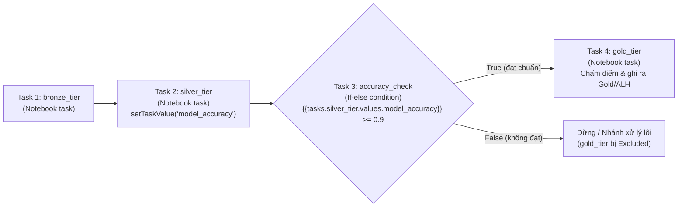

# Module 6: Automate Data Processing

> **Nguồn:** Oracle MyLearn — *Oracle AI Data Platform: Data Foundations for Analytics and AI* (4 bài học: 2 bài lý thuyết + 2 bài Demo, ~24 phút)  
> **Từ điển thuật ngữ chi tiết:** xem [glossary.md](./glossary.md)

---

## 1. Cấu trúc cốt lõi của AIDP Workflows (Lesson 1 & 2)

Sau khi code trong Notebook đã chạy chuẩn (Module 5), **AIDP Workflows** giúp biến công việc chạy tay thành **hệ thống tự động chạy lặp lại**, có lịch trình, có kiểm soát lỗi và lưu lịch sử rõ ràng.



### A. Thứ bậc khái niệm: Workflow → Job → Task → Job Run
- **Job** *(Công việc — lưu dưới dạng file `.job`, mặc định trong thư mục `jobs`)*: Gom một hoặc nhiều **Tasks** phối hợp cùng nhau để hoàn thành một mục tiêu xử lý dữ liệu.
- **Task** *(Bước thực thi)*: Một bước cụ thể bên trong Job. AIDP hỗ trợ **5 loại Task**:
  1. **`Notebook task`:** Chạy một AIDP Notebook (nguồn từ Workspace hoặc Git provider).
  2. **`Python task`:** Chạy file script Python.
  3. **`JAR task`:** Chạy gói code Java/Scala Spark đóng gói dạng `.jar`.
  4. **`If-else condition`:** Rẽ nhánh logic theo điều kiện đúng/sai (`true` / `false`).
  5. **`Nested job task`:** Gọi một Job độc lập khác chạy như một bước con bên trong Job lớn *(rất tiện để phát triển/test riêng từng job Bronze, Silver, Gold rồi ghép thành 1 Unified Workflow)*.
- **Job Run** *(Lần chạy)*: Mỗi lần Job được kích hoạt sẽ sinh một bản ghi lưu **trạng thái** (`Success`, `Failed`, `Canceled`, `Timed out`), thời gian, tham số, đầu ra và nhật ký log.

### B. Cấu hình Task, Phụ thuộc & Tham số
- **Cấu hình phổ biến trên Task:** Chọn `Cluster`, `Streaming` checkbox, **`Execution timeout`** *(tối thiểu 1 phút, tối đa 48 giờ)*, **`Retries`** *(số lần tự thử lại + tùy chọn `Retry on timeout`)*, **`Depends on`** *(chờ task nào xong)*, **`Run if`** *(vd: chỉ chạy nếu mọi task phụ thuộc đều chạy xong và thành công)*.
  - *Lưu ý:* Các task **không phụ thuộc nhau** có thể chạy **song song (in parallel)** để tiết kiệm thời gian.
- **Thứ tự ưu tiên tham số (*Parameter Precedence Order*) — CỰC KỲ QUAN TRỌNG:**
  Khi cùng một tên tham số (`key`) được khai báo ở nhiều cấp khác nhau, AIDP áp dụng thứ tự ưu tiên từ cao xuống thấp:
  1. **Job Run value** *(giá trị truyền riêng cho lần chạy đó — ưu tiên cao nhất)*
  2. **Task value** *(giá trị cấu hình ở cấp Task)*
  3. **Job value** *(giá trị mặc định cấu hình ở cấp Job — ưu tiên thấp nhất)*

### C. Truyền giá trị giữa các Task bằng `oidlutils` & If-Else (Demo 2)
1. **Ghi giá trị từ cuối Notebook Silver:**
   ```python
   oidlutils.parameters.setTaskValue('model_accuracy', f"{model_accuracy}")
   ```
2. **Đọc lại trong If-Else Condition Task (`accuracy_check`):**
   - Cú pháp chuẩn: **`{{tasks.<task_name>.values.<parameter_name>}}`**
   - Ví dụ: `{{tasks.silver_tier.values.model_accuracy}} >= 0.9` *(hỗ trợ `==`, `!=`, `>=`, `<=`, `>`, `<` và ghép nhiều điều kiện bằng `and` / `or`)*.
3. **Nối nhánh downstream (`gold_tier`):** Đặt `Depends on` là `accuracy_check true` (nếu muốn làm nhánh báo lỗi khi sai thì đặt `accuracy_check false`).
4. **System Parameters có sẵn** *(trong tab `Details → Job parameters → Add value`)*: `{{aidp.id}}`, `{{aidp.region}}`, `{{workspace.name}}`, `{{job.id}}`, `{{job.run_id}}`, `{{job.repair_count}}`, `{{job.start_time.is_weekday}}`...

---

## 2. Lập lịch, Giám sát, Repair Run & Vận hành qua API (Lesson 3 & 4)

### A. Lập lịch tự động (*Scheduling*)
- Vào Job → tab **`Details`** → mục **`Schedule` → `Add`** (cũng có chỗ chỉnh `Max concurrent Runs`, `Execution timeout` và `Git` settings).
- Hỗ trợ **2 kiểu lập lịch**:
  1. **Calendar-based schedule** *(theo lịch trực quan: chọn Time Zone, Frequency như Weekly/Daily, ngày trong tuần như Sunday, giờ 24h)*.
  2. **Cron expressions** *(biểu thức cron linh hoạt cho lịch phức tạp)*.
- Có thể để trạng thái **`Active`** (chạy luôn theo lịch) hoặc **`Paused`** (tạm dừng cho đến khi nhóm sẵn sàng).

### B. Giám sát lần chạy (*Monitoring*) & Repair Run
- Khi mở một Job Run, có **3 tab chính**:
  - **`Graph`:** Sơ đồ trực quan từng task (xanh = chạy xong; xám = `Excluded` vì nhánh điều kiện không thỏa mãn) kèm panel xem `Status`, `Duration`, `Parameters`, `Output`.
  - **`Timeline`:** Biểu đồ ngang cho biết mỗi task bắt đầu/kết thúc lúc nào (dễ nhận ra khâu bị chậm).
  - **`Details`:** Thông tin tổng quan lần chạy và **logs của Compute Cluster**.
- **Repair Run *(Chạy khôi phục thông minh)*:**
  - Nếu một pipeline dài bị lỗi ở bước giữa, **KHÔNG cần chạy lại toàn bộ từ đầu** — bấm **`Repair run`** để **chỉ chạy lại những task bị lỗi đã chọn**!
  - ⚠️ **Lưu ý quan trọng:** Mọi **parameters** bạn nhập thêm trong lúc bấm **Repair run** **CHỈ áp dụng cho lần chạy khôi phục (recovery attempt) đó**, không làm thay đổi tham số gốc của Job!

### C. Vận hành bằng lập trình (*Programmatic Operations*)
Ngoài bấm tay trên UI, bạn có thể khởi chạy job, theo dõi trạng thái và thu thập log tự động thông qua **REST APIs, SDKs và CLI** — dùng cho **scripts, runbooks, CI/CD** và tích hợp hệ thống doanh nghiệp.

### D. Nhắc lại Notifications vs. Audit Logs trong vận hành Pipeline (Demo 4)
- **Notifications** *(14 ngày gần nhất)*: Lọc nhanh theo `Resource type`, `Operation type` (`RUN_WORKFLOW_JOB`, `CREATE_CLUSTER`, `COMMIT_PUSH`...), `Status` (`Success`/`Failed`) và xem cột `Message` để gỡ lỗi job fail.
- **Audit Logs:** Chi tiết sâu hơn rất nhiều (**granular**) — ghi tận thao tác xem thư mục, tạo/sửa từng file (vd lọc theo `expense_medallion/gold`) kèm **OCID của người thực hiện**.

---

## Câu hỏi tự kiểm tra nhanh (Module 6)

1. Nếu tham số `threshold` cùng được đặt ở cả **Job level (`0.8`)**, **Task level (`0.85`)** và **Job Run level (`0.9`)**, AIDP sẽ dùng giá trị nào khi chạy?
2. Bạn có một Job gồm 4 task `Bronze → Silver → Check → Gold`. Khi chạy, `Bronze` và `Silver` thành công nhưng `Gold` bị lỗi. Bạn nên dùng tính năng nào để **chỉ chạy lại phần bị lỗi** mà không chạy lại `Bronze` và `Silver`?
3. Trong Notebook Silver, bạn muốn truyền biến `model_accuracy` sang cho một **If-Else Condition task** phía sau. Cú pháp tham chiếu tham số đó trong If-Else task có dạng như thế nào?
4. Ngoài kiểu chạy thủ công (**Manual**), AIDP hỗ trợ những kiểu lập lịch (**Schedule**) nào?
