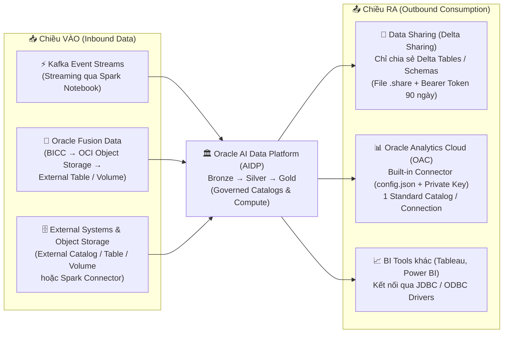

# Module 7: Share and Integrate Data

> **Nguồn:** Oracle MyLearn — *Oracle AI Data Platform: Data Foundations for Analytics and AI* (4 bài học: 2 bài lý thuyết + 2 bài Demo, ~24 phút)  
> **Từ điển thuật ngữ chi tiết:** xem [glossary.md](./glossary.md)

---

## Tổng quan 2 chiều kết nối của AIDP



---

## Phần A — Đưa dữ liệu từ AIDP ra ngoài (Outbound: Data Sharing & OAC)

### 1. Data Sharing *(Chia sẻ dữ liệu không nhân bản qua Delta Sharing)*
**Delta Sharing** là giao thức mở cho phép chia sẻ dữ liệu có quản trị cho người dùng hoặc hệ thống bên ngoài **mà không cần copy nhân bản dữ liệu gốc**.

- ⚠️ **Phạm vi đối tượng chia sẻ (rất hay hỏi!):**
  - Chỉ chia sẻ được **Delta Tables** (chọn từng bảng lẻ hoặc chọn cả **Schema** để chia sẻ tất cả bảng Delta hợp lệ bên trong).
  - **KHÔNG** phân phối tài sản dự án như **Workspace files** hay **Volumes**!

- **Quy trình 4 bước chia sẻ (từ Demo `expense_data_share`):**
  1. **Tạo Share:** Sidebar → **Data sharing** → `+` → đặt tên (vd `expense_data_share`) → **Create**.
  2. **Thêm Assets (tab `Assets`):** Chọn các Delta tables hoặc Schema (vd `silver`).
  3. **Thêm & Kích hoạt Recipient (tab `Recipients`):** Tạo người nhận (vd `audit_team`, email tùy chọn). Vào tab **Details** để kích hoạt thủ công hoặc gửi email kích hoạt:
     - *Lưu ý:* **AIDP không có mail server riêng**, nên bấm gửi sẽ mở ứng dụng email mặc định trên máy bạn kèm **một đường link kích hoạt dùng 1 lần (*one-time activation link*)**.
  4. **Người nhận truy cập từ hệ thống ngoài (vd Python/Spark trên VS Code):**
     - Mở one-time link → lấy **Credential Profile** và lưu thành file **`.share`** (vd `aidp_demo.share`).
     - Đọc bảng bằng định dạng **`share.schema.table`**:
       ```python
       table_url = f"{profile_path}#{share}.{schema}.{table}"
       df = spark.read.format("deltaSharing").load(table_url)
       ```

- **Quản lý Bearer Token & Kiểm tra Recipient *(2 điểm cực hay ra thi!)*:**
  - **Thời hạn mặc định của Bearer Token:** **90 ngày** (`60 * 60 * 24 * 90` giây). Người nhận phải **gia hạn (*refresh / extend*)** token qua HTTP request trước khi hết hạn để không bị ngắt quyền truy cập.
  - **Xem thông tin chi tiết không hiện trên UI** (như ngày hết hạn token `bear_token_expiration` và `delta_share_endpoint`): chạy câu lệnh SQL trong AIDP Notebook:
    ```python
    spark.sql("DESCRIBE recipient audit_team").show(truncate=False)
    ```

---

### 2. Kết nối Oracle Analytics Cloud (OAC) & Công cụ BI khác
Vào **Workspace → Compute → chọn Compute Cluster → tab `Connection Details`**:
- **Oracle Analytics Cloud (OAC):** Có **Built-in AIDP Connector** (bấm icon OAC để tải file `config.json`).
- **Tableau, Power BI & công cụ BI khác:** Dùng **JDBC** hoặc **ODBC driver** (có sẵn `Hostname`, `Port 443`, `JDBC URL`, `HTTP path` và nút tải driver ngay trên tab `Connection Details`).

#### Quy trình 4 bước kết nối OAC tới AIDP (Lesson 1 & Demo 4)
1. **Tải `config.json`:** Từ tab `Connection Details` của Compute Cluster đích trong AIDP.
2. **Chuẩn bị OCI API Key & kiểm tra `config.json`:**
   - Phải có **OCI API Key** cho **người tạo AIDP instance** hoặc **user có quyền Admin** (`OCI Profile → Tokens and Keys`).
   - Mở `config.json` kiểm tra và cập nhật đúng **`fingerprint`** *(dấu vân tay của API key)* và **`region`** *(phải khớp region nơi AIDP instance đang chạy, vd `us-ashburn-1`)*.
3. **Tạo Connection trong OAC:**
   - OAC → **Create → Connection → Oracle AI Data Platform**.
   - Upload **`config.json`** *(tự điền DSN, User OCID, Tenancy OCID, Region, Fingerprint)*.
   - Upload file **Private API Key (`.pem`)** khớp với fingerprint.
   - Chọn **Catalog** đích → **Save**.
   - ⚠️ **Giới hạn quan trọng:** Mỗi kết nối OAC **chỉ liên kết tới MỘT Catalog duy nhất**, và **hiện chỉ hỗ trợ Standard Catalog** *(không dùng External Catalog)*.
4. **Tạo Data Set & Workbook:** `Create → Data Set` → chọn connection → kéo bảng Gold (vd `expenses_scored_gold`) → `Save` → `Create Workbook` để tạo biểu đồ phân tích (vd chi phí theo `Business Unit`, cờ `Missing Receipt` / `Meal Limit`, xu hướng theo `Submission Month`).

---

## Phần B — Đưa dữ liệu từ bên ngoài vào AIDP (Inbound: External, Streaming & Fusion)

### 1. Chọn đúng mẫu truy cập dữ liệu ngoài (4 Patterns)
Cả 4 cách đều giữ nguyên kiểm soát quản trị thông qua **catalog objects, compute credentials và permissions**:

| Tình huống thực tế | Chọn giải pháp nào trong AIDP? |
|---|---|
| Dữ liệu nằm nguyên ở hệ thống ngoài (vd database) nhưng nhóm cần tìm kiếm & truy vấn có quản trị | **External Catalog** *(AIDP đồng bộ metadata, không copy dữ liệu)* |
| Dữ liệu **có cấu trúc** đã nằm sẵn trên OCI Object Storage cần tham chiếu trong catalog | **External Table** |
| Dữ liệu **dạng file** đã nằm sẵn trên OCI Object Storage cần tham chiếu trong catalog | **External Volume** |
| Cần **code tùy chỉnh, credentials riêng hoặc biến đổi dữ liệu** trước khi tái sử dụng | **Notebook / Spark Connector** |

### 2. Hai nguồn dữ liệu doanh nghiệp điển hình (Kafka Streaming & Oracle Fusion)
1. **Streaming Data với Apache Kafka:**
   - **Streaming** xử lý dữ liệu **liên tục ngay khi vừa phát sinh** *(continuous flow)* thay vì chờ gom theo lô định kỳ (*scheduled batch*).
   - **Apache Kafka** là nền tảng truyền sự kiện (*event streaming*) chuẩn công nghiệp. Trong AIDP, **Spark Notebooks** đọc luồng sự kiện Kafka (vd phê duyệt mới, giao dịch thẻ, biên lai, ngoại lệ), chuẩn hóa rồi ghi vào bảng được quản trị trong AIDP.
2. **Oracle Fusion Data qua BICC (*Business Intelligence Cloud Connector*):**
   - **BICC** là đường trích xuất hàng loạt (**bulk extract**) tiêu chuẩn từ **Oracle Fusion Applications**, ghi dữ liệu ra một vị trí **OCI Object Storage** được chỉ định.
   - Sau khi file đổ về Object Storage, AIDP truy cập qua **External Table** hoặc **External Volume**, rồi **Spark Notebooks** kiểm tra, nối bảng và tinh tuyển thành các bảng sạch trong AIDP.

---

## Câu hỏi tự kiểm tra nhanh (Module 7)

1. Bạn có thể chia sẻ **Volumes** hoặc **Workspace files** thông qua tính năng **Data Sharing (Delta Sharing)** của AIDP không? Loại tài sản nào mới chia sẻ được?
2. **Bearer Token** của người nhận trong AIDP Data Sharing có thời hạn mặc định bao lâu? Làm sao xem chính xác ngày hết hạn token của recipient `audit_team` nếu giao diện UI không hiển thị?
3. Khi kết nối **Oracle Analytics Cloud (OAC)** tới AIDP bằng built-in connector, một kết nối OAC gắn được tối đa mấy catalog và loại catalog nào được hỗ trợ?
4. Công cụ nào thực hiện trích xuất hàng loạt (**bulk extract**) dữ liệu từ **Oracle Fusion** đổ ra **OCI Object Storage** để AIDP đọc vào?
