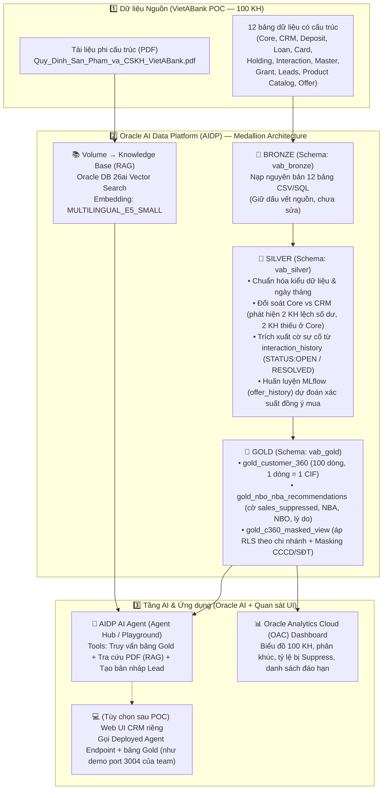

# Kế hoạch Tổng thể POC: Customer 360 — Next Best Offer (NBO) & Next Best Action (NBA) cho VietABank trên Oracle AIDP

> **Dành cho:** Data Engineer mới tiếp cận bài toán Banking Customer 360 & Oracle AI Data Platform (AIDP)  
> **Mục tiêu:** Hiểu rõ cả **Nghiệp vụ (Business)** lẫn **Kỹ thuật (Technical)**, triển khai xong bộ POC 100 khách hàng + 2 kịch bản chuẩn + PDF quy định VietABank và **tự tin báo cáo với Sếp**.

---

## 1. Giải ngố từ gốc: Nghiệp vụ (Business) là gì?

### A. Ba khái niệm cốt lõi cần phân biệt rành mạch
1. **Customer 360 *(Hồ sơ khách hàng toàn diện)*:**
   - Trong ngân hàng, thông tin 1 khách hàng bị xé lẻ ở nhiều hệ thống: **Core Banking** *(số dư tổng, xếp hạng tín dụng)*, **CRM** *(phân khúc, liên hệ)*, **Tiền gửi (Deposits)** *(sổ tiết kiệm, ngày đáo hạn)*, **Tín dụng (LOS)** *(khoản vay)*, **Thẻ (CMS)** *(thẻ ghi nợ/tín dụng, trạng thái khóa/nuốt thẻ)*, **Lịch sử tương tác (Interaction History)** *(gọi tổng đài, khiếu nại, chi nhánh)*.
   - **Customer 360** dùng mã định danh duy nhất **CIF** để gom tất cả về **1 bảng Gold chuẩn duy nhất**, kèm phát hiện lỗi lệch giữa Core và CRM (*đối soát*).
2. **Next Best Offer — NBO *(Sản phẩm tốt nhất nên chào tiếp theo)*:**
   - Trả lời câu hỏi: **"Nên BÁN sản phẩm gì cho khách này?"** (ví dụ: *Thẻ tín dụng Quốc tế VietABank Visa Platinum*, *Gói Tái tục Tiết kiệm Ưu đãi*, *Nâng hạn mức thẻ*...).
3. **Next Best Action — NBA *(Hành động tốt nhất nên làm tiếp theo)*:**
   - Trả lời câu hỏi: **"Hôm nay RM / Tổng đài nên LÀM GÌ với khách này?"**
   - ⚠️ **Điểm ăn tiền nhất khi báo cáo với Sếp:** **NBA KHÔNG PHẢI LÚC NÀO CŨNG LÀ BÁN HÀNG!**
   - Đúng như bạn đã đoán: Nếu khách đang được tư vấn thẻ mà **vừa bị nuốt thẻ ATM** *(sự cố chưa xử lý xong)*, thì hành động tốt nhất (**NBA**) là **DỪNG NGAY BÁN HÀNG (*Sales Suppression*)** và **ưu tiên gọi xin lỗi + hỗ trợ khóa/nhận lại/cấp lại thẻ (*Service Recovery*)**! Chỉ sau khi sự cố đóng (`RESOLVED/CLOSED`) và qua **48 giờ hạ nhiệt (*cooling-off*)**, hệ thống mới bật lại **NBA = Gọi hỏi thăm xác nhận thẻ ổn định + nối lại chào bán NBO**!

### B. Tài liệu PDF Quy định của VietABank dùng để làm gì?
Nhiều bạn mới làm Data Engineer hay thắc mắc *"Em có bảng SQL rồi, file PDF này để làm gì?"*. Câu trả lời cực rõ:
- **Dữ liệu có cấu trúc (12 bảng CSV/SQL)** cho AI biết **"Khách hàng đang có gì và vừa xảy ra chuyện gì"** *(số dư 6.85 tỷ, sắp đáo hạn 10 ngày, hay đang bị nuốt thẻ ATM mã `TS-20261125-001`)*.
- **File PDF Quy định VietABank (`Quy_Dinh_San_Pham_va_CSKH_VietABank.pdf`)** được upload vào **Volume** trong AIDP rồi lập chỉ mục thành **Knowledge Base (RAG)** *(dùng model `MULTILINGUAL_E5_SMALL` vì là tiếng Việt!)* để cho AI biết **"Luật chơi & quy trình chính thức của ngân hàng"**:
  1. **Làm căn cứ kiểm soát (Guardrails):** Điều 11 trong PDF quy định *cấm bán hàng khi có sự cố `STATUS: OPEN`*, Điều 12 quy định *chờ 48 giờ hạ nhiệt*.
  2. **Trả lời nghiệp vụ có trích dẫn (Citation):** Khi RM hỏi *"Thủ tục và biểu phí mở thẻ VietABank Visa Platinum là gì?"* hoặc *"Nuốt thẻ ATM xử lý trong bao lâu, có mất phí không?"*, AI tra thẳng PDF trả lời đúng từng con số (phí thường niên 800k, miễn phí cấp lại do lỗi kỹ thuật trong 3–5 ngày, hotline `1900 555 590`) **kèm trích dẫn Điều khoản** — tuyệt đối **không tự bịa**!

---

## 2. Kiến trúc Kỹ thuật trên Oracle AIDP (Bạn hiểu đúng rồi — đây là bức tranh đầy đủ!)

### Trả lời câu hỏi lớn: "Quan sát UI qua đâu? Có phải code UI không?"

**KHÔNG bắt buộc phải tự code Frontend UI để báo cáo POC!** Trên hệ sinh thái Oracle AIDP đã có sẵn **3 giao diện quan sát** cho từng đối tượng:

| Đối tượng xem | Quan sát ở UI nào? | Có cần code UI không? |
|---|---|---|
| **Data Engineer / Kỹ thuật** | **AIDP Workbench** (`Master Catalog`, `Notebooks`, `Workflows`, `Experiments`) | **Không** — xem bảng Bronze/Silver/Gold, biểu đồ chạy Workflow (`Graph`/`Timeline`) có sẵn. |
| **Sếp / Giám đốc Khối (Tổng quan 100 KH)** | **Oracle Analytics Cloud (OAC)** *(kết nối từ AIDP bằng `config.json` như Module 7)* | **Không** — kéo-thả bảng `gold_nbo_nba_recommendations` vẽ biểu đồ phân khúc, 7 KH đang bị chặn bán hàng, 11 KH sắp đáo hạn. |
| **RM / Telesales (Demo chat 2 KH chuẩn)** | **AIDP Agent Hub / Agent Playground** *(ngay nút **"Experience Agent Hub"** trên trang chủ AIDP của bạn!)* | **Không** — mở khung chat hỏi trực tiếp về CIF `200001` & `200002`, AI tự gọi bảng Gold + tra PDF + trả lời NBO/NBA. |
| ***(Tùy chọn nâng cao)*** **Demo giao diện CRM ngân hàng đẹp mắt** | Web App mỏng (Streamlit / React giống trang `138.2.103.239:3004` trong tài liệu team) | **Chỉ làm nếu Sếp yêu cầu** (sau khi Data + Agent đã chạy xong); Frontend chỉ cần gọi **Deployed Agent Endpoint** của AIDP và query bảng Gold. |

> **Vai trò cốt lõi của bạn (Data Engineer):** Bạn sở hữu 100% từ **Nguồn → Bronze → Silver → Gold → Workflow tự động → Knowledge Base → kết nối dữ liệu sạch cho AI Agent & OAC**. Đó chính là điểm mạnh nhất để bạn tỏa sáng khi báo cáo!

---

## 3. Bộ dữ liệu đã sinh sẵn & 2 (+1) Kịch bản chuẩn để trình bày

Toàn bộ dữ liệu chuẩn 100 khách hàng VietABank đã được sinh tại thư mục `vietabank_poc/`:
- **12 file CSV** *(upload thẳng vào AIDP Managed Tables)*: `vietabank_poc/data/csv/01_core_customer.csv` → `12_offer_history.csv`
- **12 file PostgreSQL `.sql`**: `vietabank_poc/data/sql/01_core_customer.sql` → `12_offer_history.sql`
- **File SQLite tổng hợp** *(test JOIN ngay trên máy)*: `vietabank_poc/data/vietabank_c360.db`
- **File PDF Quy định VietABank** *(upload vào Volume làm Knowledge Base RAG)*: `vietabank_poc/docs/Quy_Dinh_San_Pham_va_CSKH_VietABank.pdf`

### Chi tiết 2 Kịch bản Chuẩn (+1 Khách hàng đối chứng trạng thái "Sau khi xử lý")

| CIF | Họ tên | Phân khúc & CN | Tình trạng dữ liệu | Kết quả Gold & AI Agent trả ra |
|---|---|---|---|---|
| **`200001`** | **Nguyễn Minh Quân** | `Affluent` · `HN01` | Tổng tài sản 1,85 tỷ; chưa có thẻ tín dụng; ngày 20/11 RM đang tư vấn Visa Platinum → **ngày 25/11 bị nuốt thẻ ATM (`TS-20261125-001`, `STATUS:OPEN`)**. | **Cờ `SALES_SUPPRESSED = 1`** **NBA:** `SERVICE_RECOVERY` *(CẤM gọi bán hàng! Chủ động xin lỗi, cập nhật tiến độ cấp lại thẻ miễn phí trong 3–5 ngày theo Điều 8 & Điều 11 PDF)*. **NBO:** `SUPPRESSED_NO_OFFER`. |
| **`200002`** | **Trần Ngọc Lan Anh** | `Priority` · `HCM01` | Tổng tài sản **6,85 tỷ**; có sổ Tiết kiệm Online **2,5 tỷ sắp đáo hạn sau 10 ngày (`07/12/2026`)**; chưa có thẻ tín dụng; **0 sự cố mở**; tương tác rất tích cực. | **Cờ `SALES_SUPPRESSED = 0`** **NBA:** `PROACTIVE_RETENTION_CALL` *(Gọi trước hạn 7–10 ngày tư vấn tái tục + bán chéo)*. **NBO:** **VietABank Visa Platinum** + **Gói Tái tục Tiết kiệm Priority**. → AI tra PDF trích dẫn Điều 3–6, biểu phí 800k miễn năm đầu → soạn **Lead** chờ RM xác nhận! |
| **`200003`** *(Đối chứng)* | **Phạm Đức Hải** | `Affluent` · `HN01` | Từng bị nuốt thẻ ATM (`TS-20261118-009`), nhưng **đã cấp lại thẻ xong ngày 22/11 (`STATUS:CLOSED`) & qua 48h hạ nhiệt (`COOLING_OFF_PASSED:TRUE`)**. | **Cờ `SALES_SUPPRESSED = 0`** **NBA:** `POST_INCIDENT_FOLLOWUP_AND_RESUME_NBO` *(Gọi hỏi thăm thẻ mới chạy ổn chưa → nối lại tư vấn Visa Platinum theo Điều 12 PDF)*. |

### Điểm nhấn Data Quality & Dashboard trên 97 khách hàng còn lại
- **Đối soát Core vs. CRM (Silver):** Có sẵn **2 KH thiếu bên Core (`200095`, `200096`)** và **2 KH lệch số dư > 50 triệu giữa Core & CRM (`200097`, `200098`)** → chứng minh năng lực kiểm soát chất lượng dữ liệu của Data Engineer!
- **Toàn danh mục 100 KH:** `7` KH đang bị **Sales Suppressed** (gồm `200001` + `200004`–`200009`), `11` KH sắp đáo hạn tiết kiệm ≤ 15 ngày, `17` KH đủ điều kiện **Visa Platinum**, `28` KH **Visa Classic**, `3` KH **Nâng hạn mức thẻ**, `38` KH **Tiết kiệm Online**.

---

## 4. Lộ trình thực thi từng bước trên Oracle AIDP (5 Bước cho Data Engineer)

### Bước 1 — Tạo Catalog, nạp 12 bảng Bronze & tạo Knowledge Base RAG *(Áp dụng Module 3)*
1. Tạo Standard Catalog `vietabank_c360` với 3 schema: `bronze`, `silver`, `gold`.
2. Upload 12 file CSV từ `vietabank_poc/data/csv/` vào `vietabank_c360.bronze` (hoặc đẩy lên OCI Object Storage rồi dùng **Auto Populate Catalog**).
3. Trong `vietabank_c360.gold` (hoặc `bronze`), tạo Managed Volume `vietabank_policies` → upload file **`Quy_Dinh_San_Pham_va_CSKH_VietABank.pdf`**.
4. Tạo **Knowledge Base** `vietabank_policies_kb`:
   - ⚠️ **Bắt buộc chọn Embedding Model:** **`MULTILINGUAL_E5_SMALL`** *(vì tài liệu bằng tiếng Việt — tuyệt đối không chọn `ALL_MINILM_L12_V2` chỉ hỗ trợ tiếng Anh!)*.
   - Gợi ý `Chunk size`: `500`–`800` ký tự, `Chunk overlap`: `100` ký tự → thêm Data Source là Volume `vietabank_policies` → bấm **Ingest Now**.

### Bước 2 — Tạo Workspace, Compute Cluster & 3 Notebooks Medallion *(Áp dụng Module 4 & 5)*
1. Tạo Workspace `vietabank_c360_ws`, thư mục `medallion/{bronze, silver, gold}` và 1 Compute Cluster (Quickstart, Autoscale, Idle timeout 120–180p).
2. **Notebook 1 (`01_bronze_validate.ipynb`):** Kiểm tra số dòng 12 bảng, kiểu dữ liệu, kiểm tra null ở khóa `cif`.
3. **Notebook 2 (`02_silver_c360_reconcile.ipynb`):**
   - Hợp nhất các bảng quanh khóa **`cif`** (`LEFT JOIN` từ `customer_master` sang `core_customer`, `crm_customer`, `deposit_account`, `loan_account`, `card_account`, `interaction_history`).
   - Tạo cột `recon_status` (`OK` / `MISSING_IN_CORE` / `BALANCE_MISMATCH`).
   - Trích xuất các đặc trưng sự cố (`open_incident_count`, `latest_ticket_id`, `post_incident_ready`) và đặc trưng sản phẩm (`days_to_next_maturity`, `has_credit_card`, `max_card_utilization`).
   - *(Mở rộng)* Dùng **MLflow** huấn luyện mô hình dự đoán xác suất khách đồng ý mua (`propensity_score`) từ bảng `12_offer_history` rồi đăng ký vào Model Registry.
4. **Notebook 3 (`03_gold_nbo_nba.ipynb`):**
   - Áp dụng luật ưu tiên theo **Điều 10–12 PDF**: kiểm tra `open_incident_count > 0` trước → nếu có thì `sales_suppressed = 1`, `next_best_action = 'SERVICE_RECOVERY'`, `next_best_offer = 'SUPPRESSED_NO_OFFER'`; nếu không thì gán NBO/NBA theo `product_catalog` (+ điểm `propensity_score`).
   - Tạo thêm **View phân quyền/che dữ liệu (`gold_c360_masked`)** kết hợp `09_data_grant` để demo **Row-Level Security theo `branch_id`** và **Masking CCCD/SĐT** khi `can_view_pii = 0`.
   - *(Khuyến nghị)* Có thể dùng `query_model('default.oci_ai_models.google.gemini-2.5-pro', ...)` sinh sẵn cột `ai_call_script` *(gợi ý câu mở lời gọi điện cho RM)* ngay trong bảng Gold!

### Bước 3 — Tự động hóa Pipeline bằng Workflow *(Áp dụng Module 6)*
- Tạo Job `vietabank_c360_daily.job` gồm 3 task nối tiếp: `01_bronze` → `02_silver` → `03_gold` (có thể thêm `If-else` kiểm tra chất lượng dữ liệu trước khi publish Gold) và đặt lịch chạy hàng ngày (hoặc chạy tay `Run now` khi Demo live đổi trạng thái sự cố của `200001` từ `OPEN` sang `CLOSED`!).

### Bước 4 — Kết nối AI Agent (Agent Hub) & OAC Dashboard *(Áp dụng Module 7)*
- **AI Agent (trong AIDP `Agents` / `Agent Hub`):**
  - Tạo **AI Compute** (1 replica, 1 OCPU, 16GB RAM).
  - Gắn cho Agent 3 công cụ: (1) **SQL Tool** đọc bảng `vietabank_c360.gold.gold_nbo_nba_recommendations` & `interaction_history`; (2) **RAG Tool** nối tới `vietabank_policies_kb`; (3) **Action Tool** soạn bản nháp Lead (Human-in-the-loop) ghi vào `leads`.
- **OAC Dashboard:** Tải `config.json` từ Compute Cluster → nối OAC tới Standard Catalog `vietabank_c360` → kéo bảng `gold_nbo_nba_recommendations` vẽ 4 biểu đồ tổng quan (100 KH theo phân khúc, Phân bố NBO, 7 KH đang bị Sales Suppressed, Top KH sắp đáo hạn ≤ 15 ngày).

### Bước 5 — Kịch bản Báo cáo với Sếp trong 10 Phút (Chốt điểm tuyệt đối!)

| Thời gian | Phần trình bày | Bạn mở màn hình gì & Nói gì? |
|---|---|---|
| **Phút 1–2** | **Bài toán & Kiến trúc** | Mở sơ đồ Mermaid ở Mục 2: Giải thích vì sao cần gom 7 nguồn quanh **CIF** (Bronze → Silver → Gold) + gắn **PDF Quy định VietABank (RAG)** để AI không nói bừa. |
| **Phút 2–4** | **Chứng minh Data Engineering** | Mở AIDP Workbench / OAC Dashboard: Cho Sếp thấy 100 KH chuẩn ngân hàng, hệ thống tự bắt ra **4 lỗi lệch giữa Core & CRM** và **7 khách hàng đang gặp sự cố cần chặn bán hàng**. |
| **Phút 4–6** | **Demo Kịch bản 1 — NBA (`CIF 200001` Nguyễn Minh Quân)** | Mở Agent Hub hỏi: *"Hôm nay tôi gọi bán thẻ Visa Platinum cho anh Nguyễn Minh Quân (CIF 200001) được không?"* → AI **CHẶN bán hàng**, cảnh báo khách vừa bị nuốt thẻ ATM ngày 25/11 (`TS-20261125-001`), trích dẫn **Điều 8 & Điều 11 PDF** hướng dẫn RM gọi xin lỗi & hỗ trợ cấp lại thẻ miễn phí! Sau đó hỏi tiếp **`CIF 200003` (Phạm Đức Hải)** để cho Sếp thấy *sau khi xử lý xong + qua 48h hạ nhiệt, AI tự mở khóa gọi hỏi thăm & chào lại thẻ!* |
| **Phút 6–8** | **Demo Kịch bản 2 — NBO + RAG + Lead (`CIF 200002` Trần Ngọc Lan Anh)** | Hỏi AI về `CIF 200002` → AI dựng **Customer 360** (Priority 6,85 tỷ, sổ 2,5 tỷ sắp đáo hạn 10 ngày nữa, chưa có thẻ tín dụng) → gợi ý **NBO: Visa Platinum + Tái tục tiết kiệm** → hỏi tiếp *"Thủ tục & biểu phí mở thẻ Visa Platinum?"* → AI trả lời **có trích dẫn PDF** → lệnh *"Tạo Lead"* → hiện bản nháp chờ RM xác nhận (**Human-in-the-Loop**). |
| **Phút 8–10** | **Bảo mật & Kết quả đạt được** | Cho Sếp xem cơ chế **RLS theo Chi nhánh** (RM `HN01` không thấy khách `HCM01`) và **Data Masking** che CCCD/SĐT theo `09_data_grant` + chốt lại giá trị mang lại cho VietABank (tăng tỷ lệ bán chéo, bảo vệ trải nghiệm khách hàng, tuân thủ quy định 100%). |

---

## 5. Danh mục file đã chuẩn bị sẵn trong dự án

- Script sinh dữ liệu (chạy lại bất cứ lúc nào): `vietabank_poc/scripts/generate_vietabank_data.py`
- 12 file CSV nạp vào AIDP: `vietabank_poc/data/csv/`
- 12 file SQL PostgreSQL: `vietabank_poc/data/sql/`
- SQLite DB test local: `vietabank_poc/data/vietabank_c360.db`
- File PDF Quy định VietABank cho RAG: `vietabank_poc/docs/Quy_Dinh_San_Pham_va_CSKH_VietABank.pdf`
